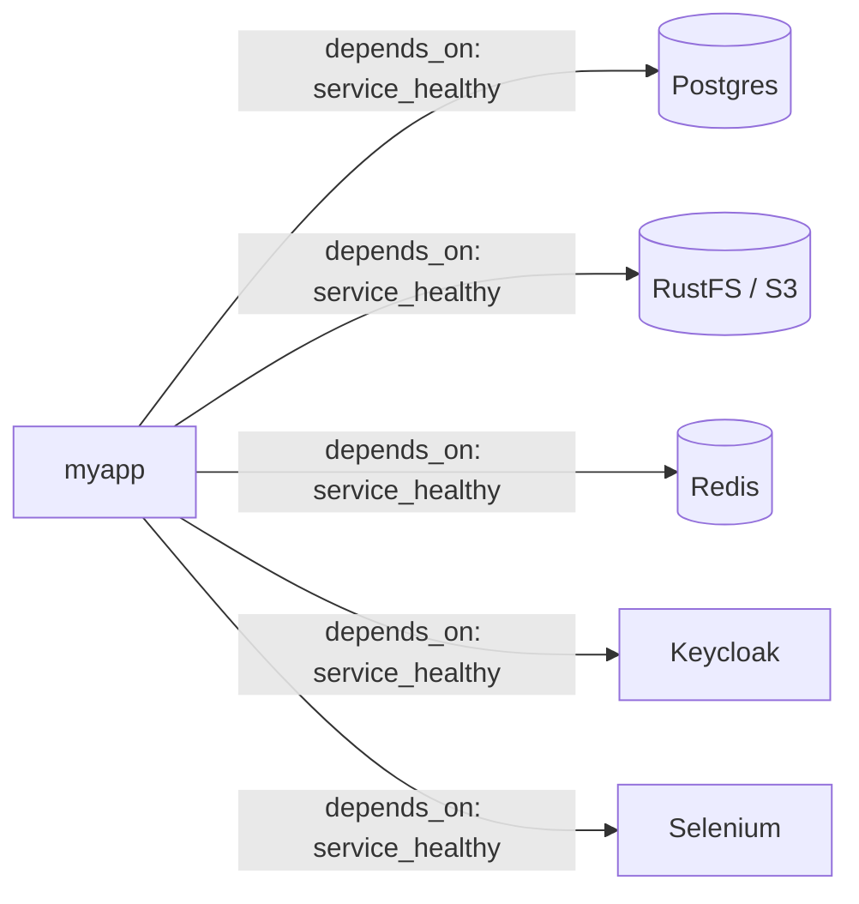
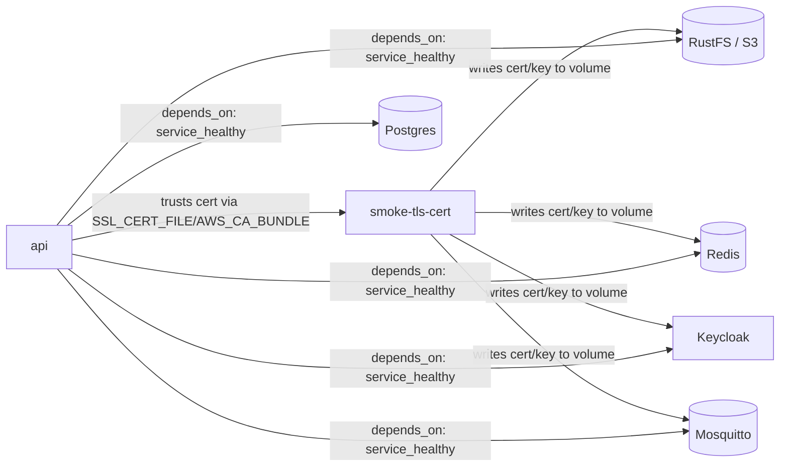

# Architecture

Infrastructure/deployment view of the system: the dev service (`myapp`) and the
supporting services it depends on, how they connect, and how the
devcontainer's stack differs from the repo-root smoke-test stack. For
the application's own internal layering and request flow, see
[system-design.md](system-design.md).

## Devcontainer stack

`.devcontainer/compose.yml` builds `myapp` from `.devcontainer/Dockerfile`'s
`develop` stage, and `.devcontainer/compose.instance.yml` pulls in
every supporting service via its `include:` list (each fragment under
[.devcontainer/stack/](../.devcontainer/stack/)): Postgres (primary
database), RustFS (S3-compatible object storage), Redis (cache/queue/
pub-sub), Keycloak (OIDC identity provider), and Selenium (a remote
browser Playwright drives for the e2e suite). `myapp` declares a
`depends_on: <service>: condition: service_healthy` entry for each one,
so Compose won't start `myapp` until every dependency's own healthcheck
passes — see
[.devcontainer/stack/README.md](../.devcontainer/stack/README.md)'s
"Devcontainer stack pattern" section for why.



No fragment declares a `networks:` block — every service already
reaches every other one by its service name on the default network
Compose generates for this project. None declares a `ports:` mapping
either: these are backend services meant to be reached only from other
containers. Keycloak is the one service a developer also needs from a
host browser (its login/admin UI), so its port is forwarded via
`forwardPorts`/`portsAttributes` in `.devcontainer/devcontainer.json`
instead of a compose `ports:` entry — the Dev Containers spec forwards
a container's port directly from its network namespace, without
publishing it via Compose. `myapp`'s own `:8000` is forwarded the same
way, for the same reason.

| Service   | Container-internal port(s) | Host-forwarded?                     |
| --------- | --------------------------- | ------------------------------------ |
| `myapp`     | 8000                         | yes — `forwardPorts` (devcontainer)  |
| postgres  | 5432                         | no                                    |
| s3        | 9000 (API), 9001 (console)  | no                                    |
| redis     | 6379                         | no                                    |
| keycloak  | 8080                         | yes — `forwardPorts` (login/admin UI) |
| selenium  | 4444                         | no                                    |

`myapp` loads each stack service's own local-dev-only credentials via
`env_file:` (the same per-service `<service>.env` files each fragment
loads itself — never re-pinned a second time), plus a handful of fixed
in-network hostname/port literals (`POSTGRES_HOST`, `S3_ENDPOINT_URL`,
`REDIS_URL`) since those are addresses, not credentials. See
[.devcontainer/stack/README.md](../.devcontainer/stack/README.md)'s
"Configuration" section for the full chain, and
[src/app/README.md](../src/app/README.md)'s "Configuration" section for
how `app.config` assembles those raw values into the settings the app
reads.

## Runner-image smoke-test stack

The repo-root [compose.yml](../compose.yml) is a separate, narrower
stack used only for CI's smoke test
([.github/workflows/README.md](../.github/workflows/README.md)'s
`smoke.yml` entry): it builds `api` from the `runner` stage instead of
`develop`, uses the same Postgres/S3/Keycloak/Redis fragments but
leaves out Selenium (nothing here needs a browser driver), and runs
with no `MODE` override so the `runner` stage's own `MODE=production`
default is what gets exercised.

Running `MODE=production` for real means also satisfying
`src/app/config.py`'s production-only guardrails, which the shared
`.devcontainer/stack/` fragments' local-dev defaults don't: Postgres/S3
credentials can't be left at those defaults, `oidc_issuer_url`/
`s3_endpoint_url` must be `https://`, `redis_url` must be `rediss://`,
and `mqtt_use_tls`/`mqtt_username`/`mqtt_password` must all be set, so
the stack runs its own Mosquitto `mqtt` service (same image pin as
`.devcontainer/stack/mqtt/`) with a TLS listener on 8883 and
`allow_anonymous false`; its config is inline (`configs:`) and its password
file is built at startup from the smoke-only credentials, and `api`
(`MQTT_HOST`/`MQTT_PORT`) depends on it being healthy so hero
create/update/delete events can publish. Postgres and S3 get
smoke-test-only credential overrides; Keycloak, Redis, S3, Postgres, and MQTT all get a
single self-signed cert with SANs for all in-network hostnames
(generated by the one-shot `smoke-tls-cert` service into a shared
`smoke-tls` volume) so each can serve TLS, with `api`'s `SSL_CERT_FILE`
(httpx, redis-py, aiomqtt) and `AWS_CA_BUNDLE` (boto3, which doesn't honor
`SSL_CERT_FILE`) pointed at that same cert so the OIDC/Redis/S3 health
checks all trust it. None of this touches the `.devcontainer/stack/`
fragments themselves — the devcontainer's own stack keeps its plain-HTTP
Keycloak/Redis/S3 and shared local-dev credentials unchanged, since
`.devcontainer/compose.yml` runs `MODE=dev`/`mock`, which don't have
these guardrails. Postgres/Redis/S3/Keycloak are all pulled in via
`extends:` (not `include:`) specifically so these overrides are possible
— `include:` errors on any field conflict with an included service
instead of merging.



Unlike every devcontainer fragment, this file *does* publish a port —
`api`'s `8000:8000` — because it exists to be curled from the GitHub
Actions runner (the host), not from a sibling container. Its
healthcheck shells out to the venv's own Python (`urllib.request`)
rather than `curl`/`wget`, since the `runner` image's slim base
installs neither.

## Kubernetes deployment (future)

Nothing in this repository deploys to Kubernetes: no manifests, operators
or autoscalers are checked in, and neither stack above uses them. This
section records what the application already supports through
configuration alone, so that a later deployment (an HA Postgres operator
such as CloudNativePG, HPA or KEDA, a progressive-delivery controller) is
pure configuration. The decisions behind it are
[ADR-0019](adrs/0019-per-pr-benchmarks-and-fixed-load-acceptance.md),
[ADR-0020](adrs/0020-extract-crud-and-observability-into-published-packages.md),
[ADR-0021](adrs/0021-opentelemetry-traces-and-metrics-pushed-over-otlp.md),
[ADR-0022](adrs/0022-db-pool-mode-per-deployment.md),
[ADR-0023](adrs/0023-http-conditional-requests-and-stats-cache.md),
[NFR-0025](nfrs/NFR-0025-observability-scope-logs-traces-and-metrics.md),
[NFR-0026](nfrs/NFR-0026-connection-pooling-per-deployment.md) and
[NFR-0027](nfrs/NFR-0027-expand-contract-migrations.md). Settings follow
[NFR-0017](nfrs/NFR-0017-config-from-environment-only.md) (environment
only). Every new variable defaults to the behavior of the devcontainer,
so existing deployments change nothing until they opt in.

### Environment variables

Defaults are those of `src/app/config.py` (`Settings`) and
`scripts/runner.sh`.

| Variable | Default | Purpose | In a cluster |
| --- | --- | --- | --- |
| `POSTGRES_HOST` / `_PORT` / `_USER` / `_PASSWORD` / `_DB` | `localhost` / `5432` / `app` / `app` / `app` | Database connection pieces | From the operator's credentials secret via `secretKeyRef` (check its key names with `kubectl`). Host is the primary's read-write service (CloudNativePG: `<cluster>-rw`) or the pooler's service. |
| `DB_POOL_MODE` | `null` | `null`: `NullPool`, a connection per use (tests, `dev`, `mock`). `local`: in-process queue pool with pre-ping. `external`: `NullPool` plus unique prepared-statement names, for PgBouncer in transaction mode. | `local` against the primary while the connection budget fits; `external` behind a pooler (CloudNativePG `Pooler`) once it doesn't. The repo-root `compose.yml` sets `local`. |
| `DB_POOL_SIZE` / `DB_MAX_OVERFLOW` / `DB_POOL_RECYCLE` | unset (SQLAlchemy defaults) | `local`-mode pool sizing | Sized against the connection budget below |
| `POSTGRES_SSLMODE` | unset (no TLS) | libpq `sslmode`, passed to asyncpg's `ssl`: `disable`, `allow`, `prefer`, `require`, `verify-ca`, `verify-full` | `require` or `verify-full`. `MODE=production` refuses to start unless it is `require`, `verify-ca` or `verify-full`. |
| `DB_CONNECT_TIMEOUT` / `DB_COMMAND_TIMEOUT` | unset (asyncpg defaults) | asyncpg `timeout` / `command_timeout`, in seconds | Short values, so requests fail fast during a failover instead of hanging (node-failure detection takes about 40-55 s by default) |
| `RUN_MIGRATIONS_ON_STARTUP` | `true` | Whether the lifespan runs `alembic upgrade head` | `false` whenever several replicas could race or a canary runs; migrations then run as a separate Job (see below) |
| `GRACEFUL_SHUTDOWN_TIMEOUT_SECONDS` | unset (server default) | `runner.sh` passes it to uvicorn's `--timeout-graceful-shutdown`; under Granian it sets `GRANIAN_WORKERS_KILL_TIMEOUT` | Bounds how long a scale-down waits for open connections (SSE streams never end on their own). Measured: 10 s. |
| `APP_SERVER` | `uvicorn` | `uvicorn` or `granian`; any other value exits 64 | Leave `uvicorn`: Granian measured +0.8% CPU per request, no gain |
| `UVICORN_*` (`UVICORN_WORKERS`, `UVICORN_LIMIT_CONCURRENCY`, `UVICORN_ACCESS_LOG`, `UVICORN_PROXY_HEADERS`, `UVICORN_BACKLOG`, `UVICORN_TIMEOUT_KEEP_ALIVE`, ...) | unset | Read natively by uvicorn's CLI. `--limit-concurrency` makes uvicorn answer 503 itself, before the app runs, so that response is plain text. | One worker per pod (the default), scaling by adding pods. `UVICORN_PROXY_HEADERS` behind an ingress. Access log off measured only -2.1% CPU per request, so it stays on. |
| `APP_VERSION` / `APP_COMMIT` | empty (baked in by the `Dockerfile` build args) | Release version and commit. `APP_VERSION` also namespaces stats-cache keys and is what `/health/info` reports; set `service.version` to the same value. | Set at build time (`make build`), not per deployment |
| `GC_FREEZE` | `true` | `gc.collect(); gc.freeze()` once startup finishes | Leave on. A/B within noise (+0.6% off), kept for robustness. |
| `HEALTH_INFO_ENABLED` | `false` | Exposes `GET /health/info` (version and commit) | Off unless the canary analysis or operators need it, because it discloses the version |
| `PROFILING_ENABLED` | `false` | Honors `?profile=1` with a pyinstrument HTML profile. Startup fails under `MODE=production`. | Never in production |
| `STATS_CACHE_TTL_SECONDS` | unset (cache off) | Lifetime of a cached `/stats` or `/predict` response in Redis. Writes invalidate through the CRUD event stream; the TTL is the safety net. Keys include the app version and the caller's scope. | Set to a short TTL if aggregates are hot ([ADR-0023](adrs/0023-http-conditional-requests-and-stats-cache.md)) |
| `OTEL_EXPORTER_OTLP_ENDPOINT` | unset (telemetry off) | Master switch for logs, traces and metrics over OTLP/HTTP. OTel's own standard variables are the only telemetry configuration, never re-modeled on `Settings`. | The OTel Collector, or Prometheus 3's OTLP receiver (`--web.enable-otlp-receiver`, HTTP only) |
| `OTEL_SERVICE_NAME`, `OTEL_RESOURCE_ATTRIBUTES` | none | Resource attributes shared by all signals | Include `service.version`, `deployment.environment` and `k8s.pod.name=$(POD_NAME)` (Downward API) so metrics split per pod and per version |
| `OTEL_TRACES_SAMPLER` / `OTEL_TRACES_SAMPLER_ARG` | SDK default (always on) | Trace sampling | **`parentbased_traceidratio` with `0.1`** (see overhead below) |
| `OTEL_TRACES_EXPORTER` / `OTEL_METRICS_EXPORTER` / `OTEL_LOGS_EXPORTER` | `otlp` | Per-signal switch (`otlp` or `none`) | `OTEL_LOGS_EXPORTER=none` is the lever if the log bridge's cost matters |
| `OTEL_METRIC_EXPORT_INTERVAL` | SDK default | Metric export interval in milliseconds | Default is fine |
| `OTEL_SDK_DISABLED` | unset | Full kill switch | Emergency off |
| `OTEL_PYTHON_FASTAPI_EXCLUDED_URLS` | none | Routes excluded from tracing | `/health/.*`, so probes don't flood traces |

Telemetry overhead, measured at the reference budget of 1 vCPU / 2 GiB
against a perf-only collector with a `nop` exporter, 25 users, versus
7.24 ms CPU per request and p99 69 ms with telemetry unset
([ADR-0021](adrs/0021-opentelemetry-traces-and-metrics-pushed-over-otlp.md)):

| Sampling | CPU per request | p99 | Capacity |
| --- | --- | --- | --- |
| 100% | 8.07 ms (+11.4%) | 74 ms (+7.2%) | 100 users (-23%) |
| 10% | 7.79 ms (+7.5%) | 71 ms (within spread) | 130 users (unchanged) |

Most of the 10% cost is the OTLP log bridge and metrics export, which
stay on at any sampling ratio once the endpoint is set. Hence the
recommended default: `OTEL_TRACES_SAMPLER=parentbased_traceidratio`,
`OTEL_TRACES_SAMPLER_ARG=0.1`.

### Database

- **Topology.** Keep all traffic on the primary's read-write service, not
  on read replicas: the CRUD layer assumes it reads its own writes, and
  replication lag would break that.
- **Failover.** Map lost-connection errors to 503 with `Retry-After`,
  and never auto-retry writes. `/health/live` doesn't touch the database
  ([NFR-0008](nfrs/NFR-0008-health-check-isolation.md)), so a failover
  doesn't restart app pods.
- **Connection budget.** The formula (`local` mode):

  ```text
  max replicas x workers x (DB_POOL_SIZE + DB_MAX_OVERFLOW)
      < max_connections - reserved slots - headroom for migrations and admin sessions
  ```

  While it fits, use `local`: one network hop fewer, and no extra process
  taking CPU (on a 1 vCPU pod a PgBouncer sidecar competes with the app
  for the same core). The autoscaler's `maxReplicas` is bounded by this
  formula. Above it, switch to `DB_POOL_MODE=external` behind a pooler in
  transaction mode with an explicit non-zero `max_prepared_statements`,
  and verify that prepared statements don't pile up on server
  connections. `external` is covered only by unit tests; live-test it on
  the first deployment that sits behind a pooler.
- **Why `local`.** Against `null`, `local` measured 7.31 vs 19.11 ms CPU
  per request (-61.7%), p99 68 vs 200 ms
  ([ADR-0022](adrs/0022-db-pool-mode-per-deployment.md),
  [NFR-0026](nfrs/NFR-0026-connection-pooling-per-deployment.md)).

### Autoscaling

**Sizing input.** One pod at the reference budget of 1 vCPU / 2 GiB with
`DB_POOL_MODE=local` sustained **130 users at about 1 request per second
per user** (final capacity run, 10-user steps; the baseline before this
work was 35). Set the scaling target to about 60-70% of that
per-pod capacity, which is roughly 80-90 concurrent users' worth of load
per pod. Re-measure after changing the pod size or the hardware
([ADR-0019](adrs/0019-per-pr-benchmarks-and-fixed-load-acceptance.md)).

**Scaling metric.** FastAPI instrumentation emits
`http.server.active_requests` and `http.server.request.duration`. After
Prometheus's OTLP name translation the first is
`http_server_active_requests`; KEDA's Prometheus scaler can use the
average in-flight requests per pod, split by the `k8s.pod.name`
resource attribute.

| Concern | Setting |
| --- | --- |
| Pod autoscaling | KEDA `ScaledObject` with the Prometheus scaler on in-flight requests per pod, or plain HPA on CPU as the simpler start. `minReplicaCount` of at least 2. |
| Scale to zero | No. Every first request would wait for a cold start, KEDA's HTTP add-on puts its proxy in front of all traffic, and long-lived SSE connections don't fit. |
| Requests and limits | CPU request 1, memory request = memory limit = 2Gi (the reference budget). No CPU limit, or one equal to the request: CFS throttling hurts tail latency. |
| VPA | Recommendation-only (`updateMode: "Off"`) to validate requests. Never VPA and HPA on the same CPU or memory metric. In-place resize can't shrink a Python process's memory without a restart. |
| Node autoscaling | Karpenter or Cluster Autoscaler size nodes from *requests*, so accurate requests matter. Add a PodDisruptionBudget (for example `maxUnavailable: 1`), because consolidation evicts pods. |
| Termination | `preStop` sleep of about 5-10 s (the built-in `sleep` action, Kubernetes 1.30+) so endpoint removal propagates before shutdown starts. `terminationGracePeriodSeconds` greater than the preStop sleep plus `GRACEFUL_SHUTDOWN_TIMEOUT_SECONDS`. There is no readiness drain in the app: Kubernetes removes terminating pods from Service endpoints. |
| Probes | `startupProbe` and `readinessProbe` on `/health/ready`, `livenessProbe` on `/health/live` (never touching the database, [NFR-0008](nfrs/NFR-0008-health-check-isolation.md)). Time to ready was 1.59 s at the baseline. |
| Scheduled jobs | `python -m app.maintenance` (set `ARCHIVE_PURGE_AFTER_DAYS`) belongs in a CronJob; the app has no scheduler. |

Pods are stateless: rate limiting and the stats cache live in Redis, auth
is a stateless JWT, files are in S3, and the JWKS cache is per pod by
design. `runner.sh` `exec`s the server as PID 1, so it receives
`SIGTERM`, stops accepting connections, finishes requests in flight and
disposes the engine in the lifespan shutdown. Measured under load with
`GRACEFUL_SHUTDOWN_TIMEOUT_SECONDS=10`: all 2256 requests accepted before
`SIGTERM` completed without a 5xx, and the container exited 0 within
0.19 s; new connections after the signal are refused, as expected. `/events`
SSE streams hold a terminating pod open until the shutdown timeout, which
is acceptable because clients resume from `Last-Event-ID` through the
broker's persistent MQTT session. A multi-replica rolling restart needs a
load balancer and was not measured.

### Canary releases and migrations

Goal: a progressive-delivery controller runs the old and new versions
side by side against one database, compares them in Prometheus, and rolls
back automatically.

| Concern | Setting |
| --- | --- |
| Controller | Argo Rollouts (with Argo CD) or Flagger (with Flux), whichever matches the GitOps tool in use |
| Traffic split | Ingress or Gateway API weights, or a mesh (for example Istio) when header or cookie pinning is needed |
| Steps | For example 5% -> 25% -> 50% -> 100%, each held for several analysis intervals |
| Analysis | Prometheus: error ratio and p95 of `http.server.request.duration` per `service.version`. Roll back automatically on breach. |
| Migrations | A migration Job before the first canary step, against the primary's read-write service directly. Contract migrations ship only in a later release. |

Migration rules ([NFR-0027](nfrs/NFR-0027-expand-contract-migrations.md);
applied migrations stay untouched, [NFR-0019](nfrs/NFR-0019-migrations-immutable-once-applied.md)):

- **Never from a canary pod.** Deploy with `RUN_MIGRATIONS_ON_STARTUP=false`.
  Otherwise the first canary pod changes the schema under the stable
  version, and a rollback of the code wouldn't undo it.
- **Migration Job.** Run `alembic upgrade head` as a Job (using the
  application image) before the rollout, connecting to the primary
  directly rather than through a pooler. Migrating through PgBouncer in
  transaction mode is another reason to keep it off the startup path.
- **Expand, then contract.** Every migration must work with the previous
  release's code. Split a breaking change into *expand* (add nullable or
  defaulted columns and tables, backfill in batches), switch the code
  over, then *contract* (drop the old structures) in a later release,
  once the previous one is fully rolled out. One-step conversions like
  `convert_hero_superpower_to_powers_list` are no longer allowed.
- **Checks.** `migration-compat.yml` runs the latest release's
  integration and e2e suites against a database migrated to the PR's
  head (it skips until a release contains `RUN_MIGRATIONS_ON_STARTUP`),
  and the Squawk `prek` hook (`scripts/lint-migrations.sh`) flags locking
  or rewriting operations such as a `NOT NULL` column without a default
  or a non-concurrent index.
- **Cross-version data.** MQTT event payloads only gain fields, never
  rename or remove them, because both versions read them
  ([ADR-0015](adrs/0015-mqtt-for-crud-events.md),
  [ADR-0017](adrs/0017-linear-forecast-and-json-only-events-for-crud-stats.md)).
  Stats-cache keys include the app version.
- **Web UI skew.** A page served by one version may submit to the other,
  so keep form fields and web-component endpoints compatible across one
  release; where that isn't possible, pin web traffic per user with a
  header or cookie match (both controllers support it).
- **Version on all telemetry.** `service.version` is the release version
  (`APP_VERSION`), so canary analysis can split error ratio and p95 by
  `service_version`.

## Do

- Base any change to this document's diagram on
  [.devcontainer/stack/README.md](../.devcontainer/stack/README.md),
  [.devcontainer/compose.yml](../.devcontainer/compose.yml), the
  repo-root [compose.yml](../compose.yml), and each stack service's own
  `README.md` — not on assumptions about what a service does.

## Don't

- Restate a stack service's connection details (credentials, exact
  image tag) here — those live in that service's own `README.md` under
  `.devcontainer/stack/`, which stays the single source of truth.
