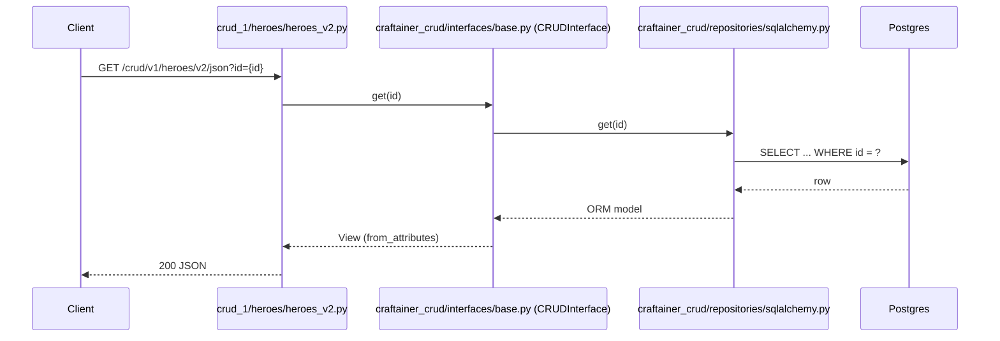

# app/

The FastAPI application package (`app.main:app`), laid out as an MVC-ish
split across subpackages, each with its own `README.md`. Paths below that start with
`craftainer_crud/` or `craftainer_observability/` are in the published
`craftainer-crud` / `craftainer-observability` packages, not in this tree:

- `models/` — the Model layer: each resource's own SQLAlchemy ORM model
  (e.g. `hero.py`). The generic base/mixins/revision model live in
  `craftainer_crud/models/` instead — see "Example CRUD resource: Hero" below.
- `views/` — the View layer: each resource's own Pydantic schemas (e.g.
  `hero_v1.py`/`hero_v2.py`). The generic view bases live in
  `craftainer_crud/views/` instead.
- `controllers/` — FastAPI routers with no resource of their own
  (audit/mock). The generic CRUD router factories a resource builds on
  live in `craftainer_crud/controllers/` instead.
- `crud_1/` — one subpackage per resource (e.g. `heroes/`), each
  combining its versioned sibling routers (built from `craftainer_crud/
  controllers/`'s factories) into one router, all combined into the
  single router `main.py` mounts at `/crud/v{ROUTER_VERSION}`; see its
  own `README.md`.

The generic CRUD framework itself — router factories, the interface,
storage-agnostic repositories, and model/view bases — lives in the
sibling `craftainer_crud/` package, not here; see its own `README.md`. A
resource's own model/view/router (Hero's, e.g.) stays in `app/` and
imports from `craftainer_crud.*` to build on that framework. The generic health
check framework (interface, registry, and router factory) similarly
lives in the sibling `craftainer_observability/health/` package, not here — see its own
`README.md` — with `health_checks.py`'s concrete checks and wiring
(below) built on top of it, the same split as a resource's own
model/view/router built on `craftainer_crud.*`.

`config.py`/`main.py`/`oidc.py`/`problem_details.py`/
`rate_limit.py`/`http_headers.py`/`db.py`/
`maintenance.py`/`health_checks.py` stay flat, outside any subpackage —
a flat module has no resource-specific code and no state of its own
beyond what it's explicitly passed or reads from `app.config`.

- `config.py` — settings, read from environment variables; see
  "Configuration" and "MODE" below.
- `main.py` — FastAPI app instance, router wiring, telemetry/middleware wiring
  and the lifespan hook (migrations, JWKS prefetch, cache invalidation, GC freeze,
  engine disposal); see "Startup, shutdown and middleware wiring" and "Alembic
  migrations" below.
- `oidc.py` — provider-agnostic OIDC bearer-token validation (PKCE-
  compatible; not Keycloak-specific); see "OIDC / auth" below.
- `problem_details.py` — RFC 9457 error responses; see below.
- `rate_limit.py` — the Redis-backed async limiter applied to
  `POST /mock/token` and each resource's bulk update/delete routes; see
  "Rate limiting" below.
- `cache.py` — `RedisStatsCache`/`InMemoryStatsCache` (the latter under `MODE=mock`),
  implementations of `craftainer_crud.interfaces.cache.StatsCache` for the shared
  `/stats`/`/predict` cache; `build_stats_cache(settings)` (None unless
  `STATS_CACHE_TTL_SECONDS` is set); and `run_invalidation(cache, source, *, resource,
  ...)`, the per-replica task that empties a resource's entries on every CRUD event.
  See "Stats cache" below.
- `http_headers.py` — the `Sunset`/`Deprecation` header dependency and
  the baseline security-headers middleware; see "Sunset/Deprecation
  headers" below.
- `analytics.py` — `AnalyticsContextMiddleware`, which hands each request's Global Privacy
  Control / DNT / consent signals to `craftainer_observability.analytics`' `track()`; see
  "Product analytics" below.
- `db.py` — the async `engine` and `session_factory` (`NullPool`), built
  from `Settings.database_url`. `crud_1/wiring.py` hands the session
  factory to `craftainer_crud`; `health_checks.py` and
  `maintenance.py` use these too.
- `crud_1/wiring.py` — the one place `app` wires `craftainer_crud`:
  it builds `CrudConfig` from `Settings`, calls
  `craftainer_crud.config.configure(...)`, and exposes `bulk_rate_limit`
  (`limiter.limit(...)`), which each resource router passes to
  `build_resource_router(bulk_rate_limit=...)`. Resource modules import it
  so the config is installed before any router is built. (`xml_codec` and
  `web_components` now live in `craftainer_crud`.)
- `maintenance.py` — `purge_archived`, the out-of-request-path job that
  hard-deletes rows past `Settings.archive_purge_after_days` for every
  model carrying `craftainer_crud.models.mixins.Archivable`; invoked externally
  (`python -m app.maintenance`) by a host/k8s `CronJob`, never from
  `main.py` — see "Example CRUD resource: Hero" below and its own module
  docstring.
- `health_checks.py` — this app's concrete `HealthCheck`s (Postgres,
  Redis, S3, OIDC) built on `craftainer_observability.health.base`, and `get_health_registry`,
  the `lru_cache`d factory (matching `app.config.get_settings`'s
  pattern) that wires them into a `craftainer_observability.health.registry.HealthRegistry`;
  `main.py` passes it to `craftainer_observability.health.router.build_health_router` to mount
  `/health`.

## Layering

Import order between all of the above is strict and one-directional —
lower layers never import from higher ones (`config` → `db` →
`analytics` → `health_checks`
→ `cache` → `rate_limit` → `problem_details` → `oidc` → `models` →
`maintenance` → `views` →
`http_headers` → `controllers` → `crud_1` → `main`) — enforced by
`import-linter`'s `"app layers"` contract in `../../pyproject.toml`'s
`[tool.importlinter]`, run via `uv run lint-imports` (wired into
`../../.pre-commit-config.yaml`'s manual/pre-push stage, same as mypy).
A new subpackage or flat module gets added to that `layers` list at the
point matching its real dependencies, not appended blindly to one end --
`maintenance` sits directly above `models` (the only layer it imports from,
besides `config`/`oidc`/`problem_details`/`rate_limit` below
that) since nothing else in `app/` imports it back (it's invoked externally,
`python -m app.maintenance`, never from `main.py`); `health_checks` sits
directly above `config` for the same reason -- its only dependency
within `app/` is `db` (its other imports, `craftainer_observability.health.base`/`craftainer_observability.health.registry`, are outside this container
entirely) and nothing else in `app/` imports it back (only `main.py`
does, to build the health router).
`crud_1` sits between `controllers` and `main` specifically because a
resource package imports `craftainer_crud/controllers/crud_router.py`'s
factories to build its own routers, and `main` imports the finished
combined router from `crud_1` rather than reaching into `controllers`
for it. This contract covers only ordering *within* `app/` itself — the
generic CRUD framework in `craftainer_crud/` has its own separate
`"crud layers"` contract and its own import order, documented in its
own `README.md`; `app/`'s resource-specific modules (`models/hero.py`,
`views/hero_v1.py`/`hero_v2.py`, `crud_1/`) import from `craftainer_crud.*` freely,
but nothing in `craftainer_crud/` ever imports back from `app/`'s resource-specific
modules (it imports nothing from `app` at all; the `"crud never imports app"`
import-linter contract enforces this). The sibling `craftainer_observability/health/` package has its own separate
`"health layers"` contract too, documented in its own `README.md`;
`health_checks.py` imports from it freely (`craftainer_observability.health.base`/
`craftainer_observability.health.registry`), and `main.py` builds the finished router by calling
`craftainer_observability.health.router.build_health_router(get_health_registry)` the same way
it imports `crud_1`'s finished router.

An arrow means "may import from" — each module may depend on anything
to its left, never anything to its right.

## Configuration

No application `.env` file: `config.py` reads settings from the process
environment only, which the compose files populate — see
`../../.devcontainer/stack/README.md`'s "Configuration" section for
where those values come from. `config.py` assembles any composed
connection string (`DATABASE_URL`) or renames a raw value to its own
generic field (`s3_access_key` from `RUSTFS_ACCESS_KEY`) at runtime,
since Compose can't interpolate a value from one env file into another
compose file's own env var. Values that are already a full, opaque,
provider-shaped string (the `OIDC_*` URLs) are written that way directly
in the owning service's env file instead, so `config.py` never has to
know a specific provider's URL scheme. Fixed in-network hostnames/ports
are not credentials and stay as plain literals in the consuming compose
file (e.g. `myapp`'s `POSTGRES_HOST: postgres`), not in an env file.

Database connection settings (`app.db.build_engine` consumes them; defaults
keep the NullPool, no-TLS, no-timeout behavior):

| Variable | Default | Meaning |
| --- | --- | --- |
| `POSTGRES_SSLMODE` | unset (no TLS) | libpq sslmode: `disable`, `allow`, `prefer`, `require`, `verify-ca`, `verify-full`, passed to asyncpg's `ssl`. Must be `require`, `verify-ca` or `verify-full` under `MODE=production`. |
| `DB_POOL_MODE` | `null` | `null`: NullPool, a connection per use (default and test mode). `local`: in-process `AsyncAdaptedQueuePool` with `pool_pre_ping`; the root `compose.yml` api uses it. `external`: NullPool plus unique prepared-statement names, for PgBouncer in transaction mode. |
| `DB_POOL_SIZE` | unset (SQLAlchemy default) | `local` mode pool size, integer >= 0. |
| `DB_MAX_OVERFLOW` | unset (SQLAlchemy default) | `local` mode: extra connections beyond the pool size, integer >= 0. |
| `DB_POOL_RECYCLE` | unset (SQLAlchemy default) | `local` mode: seconds before a pooled connection is recycled, integer >= 0. |
| `DB_CONNECT_TIMEOUT` | unset (asyncpg default) | asyncpg `timeout`: connect timeout in seconds, > 0. |
| `DB_COMMAND_TIMEOUT` | unset (asyncpg default) | asyncpg `command_timeout`: per-command timeout in seconds, > 0. |
| `RUN_MIGRATIONS_ON_STARTUP` | `true` | Whether the api runs Alembic migrations on startup. |

Process-wide switches `main.py` consumes (see "Startup, shutdown and middleware wiring" below):

| Variable | Default | Meaning |
| --- | --- | --- |
| `GC_FREEZE` | `true` | Run `gc.collect(); gc.freeze()` once startup finishes, so the import-time object graph stops being rescanned by the cyclic GC. A switch so a load test can A/B it without a rebuild. |
| `HEALTH_INFO_ENABLED` | `false` | Mount `GET /health/info` (`{"version", "commit"}` from `APP_VERSION`/`APP_COMMIT`, falling back to the installed `template-fastapi` distribution's version). Off because it discloses the version. |
| `PROFILING_ENABLED` | `false` | A request with `?profile=1` is answered with a pyinstrument HTML profile. Startup fails (`ProfilingDisabledError`) under `MODE=production`. pyinstrument is a dev dependency only. |

## Stats cache

`GET <prefix>/stats` and `/predict` are whole-table aggregates, not per-user data, so
they are the only responses cached server-side (per-record and list responses are not:
heroes are owner-scoped, see ADR-0011). Off unless set:

| Variable | Default | Meaning |
| --- | --- | --- |
| `STATS_CACHE_TTL_SECONDS` | unset (cache off) | Lifetime in seconds of a cached `/stats`/`/predict` body, integer > 0. Also the staleness bound if an invalidation event is missed. |

Event-stream subscriber ids are minted and signed by the server (`craftainer_crud` 0.3):
a client can only hand back an id it was given, so `?subscriber_id=` / `Last-Event-ID` resume a
session only if the id verifies. By default the signing key is random per process, so ids
survive neither a restart nor a second worker; set `SUBSCRIBER_SECRET` (at least 32
characters, the same on every replica) to let clients resume across both. It is required
under `MODE=production`: `config.py` refuses to construct `Settings` without it. `dev`/`mock`
leave it unset and use the per-process key.

`app.cache.build_stats_cache(settings)` returns the cache (Redis over `REDIS_URL`, so
`rediss://` TLS works as for rate limiting; in-process under `MODE=mock`), which is
passed to the router factories as `stats_cache=`. Redis keys are
`stats-cache:<APP_VERSION>:<resource>:<hash>`; the version keeps a canary release's
differently-shaped responses apart. Writes publish CRUD events (ADR-0015); each replica
runs `app.cache.run_invalidation(cache, event_source, resource=...)`
as a lifespan background task, which empties the resource's entries on every event (and
once per (re)subscribe). It subscribes transiently (`source.subscribe(None, durable=False)`,
`craftainer_crud` 0.4): a fresh id and a clean MQTT session each time, which the broker
drops when the connection ends, whether it closes cleanly or crashes, so a replica leaves
no session behind and nothing is resumed (the subscriber ids above matter to clients of
`GET /events`, not to this task). A read racing a write, or an event published while the
task was disconnected, can still leave a stale body, so the TTL stays the safety net. A Redis outage degrades to uncached responses.

## Startup, shutdown and middleware wiring

`main.py` wires every optional piece in one place; each is off or a no-op unless its
setting asks for it.

Lifespan, in order: Alembic migrations (off the event loop; skipped under `MODE=mock` or
`RUN_MIGRATIONS_ON_STARTUP=false`), `oidc.prefetch_jwks()` (warm-only, an unreachable
IdP just logs), the stats-cache invalidation task (only when `STATS_CACHE_TTL_SECONDS` is
set: `app.cache.run_invalidation` over Hero's event source, `resource="hero"`; each (re)subscribe is transient, `durable=False` with a fresh id), then `gc.collect(); gc.freeze()` (unless
`GC_FREEZE=false`). Shutdown runs in reverse: cancel and await the invalidation task,
close the Redis cache client, close the health registry's Redis check
(`close_health_checks()`), then `engine.dispose()` so pooled connections close cleanly.
`crud_1/wiring.py` builds the `stats_cache` once at import time because the Hero v2
router takes it as `stats_cache=`.

Telemetry and request IDs: `configure_telemetry()` runs before the app is built, then
`instrument_app(app)` and `instrument_engine(app.db.engine)` (both no-ops without
`OTEL_EXPORTER_OTLP_ENDPOINT`) and `RequestIDMiddleware` (`X-Request-ID` echoed, bad
values replaced, ID on JSON log lines and the server span). The OTel server span wraps
the whole user-middleware stack regardless of call order, so the request-ID middleware
always runs inside it; the order is also explained in a comment at the bottom of
`main.py`. Profiling (`PROFILING_ENABLED`) sits inside both and outside the security
headers, so the profile page isn't subject to the strict CSP.

Under `MODE=production`, `/docs`, `/redoc` and `/openapi.json` are not served.

`alembic/env.py` only applies `alembic.ini`'s logging config when the root logger has no
handlers (the standalone `alembic` CLI), so a process that migrates on startup keeps its
JSON log lines and OTLP log bridge. `configure_logging()` also hands uvicorn's own
loggers over to the root handlers, so its lines are JSON too.

## Product analytics

([ADR 0027](../../docs/adrs/0027-product-analytics-with-track.md),
[FR-0026](../../docs/frs/FR-0026-product-analytics-events.md),
[NFR-0028](../../docs/nfrs/NFR-0028-analytics-privacy.md))

`craftainer_observability.analytics` (the `analytics` extra) reads the `ANALYTICS_*`
variables itself, so `config.py` has no fields for them. Off unless a backend is set
(`none` by default; the devcontainer's `umami.env` selects `umami`):

| Variable | Default | Meaning |
| --- | --- | --- |
| `ANALYTICS_ENABLED` | `true` | `false` turns every `track()` into a no-op. |
| `ANALYTICS_BACKEND` | `none` | `none`, `log` (one JSON log line per event), `umami` or `otel`. |
| `ANALYTICS_ENDPOINT` | unset | Umami's base URL; the adapter appends `/api/batch`. Must be the final URL (redirects are not followed). |
| `ANALYTICS_SITE_ID` | unset | Umami website ID. |
| `ANALYTICS_HOSTNAME` | unset | Sent as `payload.hostname`. |
| `ANALYTICS_CONSENT` | `implied` | `opt-in` records nothing unless the request sends `Analytics-Consent: 1`. |
| `ANALYTICS_RESPECT_GPC` | `true` | Drop events of a request with `Sec-GPC: 1` or `DNT: 1`. |
| `ANALYTICS_GEO` | `none` | `none` or `coarse`; backend events carry no client address, so no geography either way. |
| `ANALYTICS_PROP_KEYS` | empty | Comma-separated prop keys allowed through; the sample events use `powers_count`. |

`main.py` adds `AnalyticsContextMiddleware` (pure ASGI), which wraps each request in the
library's `request_context(gpc=, consent=)` from those headers; `track()` consults it. Hero
create and delete are recorded as `hero.created` / `hero.deleted` by
`crud_1/analytics_events.py`'s `AnalyticsEventSink`, a wrapper around Hero's `EventSink`.
`track()` never raises or blocks, and the lifespan flushes the queue once on shutdown. Tests
(`tests/unit/conftest.py`'s autouse fixture) clear every `ANALYTICS_*` variable, so none
reaches a real backend. The privacy rules a new event must keep are in NFR-0028: scalar
props on the allowlist, no personal data, path-only `url`.

## Alembic migrations

Pending migrations apply automatically: `main.py`'s FastAPI `lifespan`
runs `alembic upgrade head` (off the event loop, via `asyncio.to_thread`
— Alembic's async recipe in `../../alembic/env.py` runs its own
`asyncio.run` internally, which can't nest inside one already running)
before the app starts serving. That only fires for a real ASGI startup
(`uvicorn`, the `runner` image, `tests/e2e`) — a bare `TestClient(app)`
in `tests/unit`/`tests/integration` never triggers lifespan, so those
suites need the schema already migrated; the devcontainer's own
`postCreateCommand` runs `uv run alembic upgrade head` once up front for
exactly that reason. `../../alembic.ini`/`../../alembic/` are resolved
relative to the current working directory (plain
`Config("alembic.ini")`), which is the repo root under the
devcontainer/pytest and `/app` in the `runner` image (see the
Dockerfile's `runner` stage, which `COPY`s both there) — never hardcode
a different path. See `../../alembic/README.md` for how migrations
themselves are authored.

`../../scripts/runner.sh` stays a plain entrypoint — migrations run from
Python, in `main.py`'s lifespan, never from the shell script.

## OIDC / auth

`../../.devcontainer/stack/keycloak/` runs Keycloak with dev-mode realm
auto-import; see its own `README.md` for the realm/client/test-user
details. `oidc.py` validates bearer tokens against it via generic OIDC
discovery + JWKS (`PyJWKClient`), with no Keycloak-specific code — any
Authorization Code + PKCE provider works by pointing
`OIDC_ISSUER_URL`/`OIDC_AUTHORIZATION_URL`/`OIDC_TOKEN_URL` elsewhere.
Add auth to a route with `Depends(get_current_claims)`; routes that
don't take that dependency stay public.

JWKS I/O stays off the event loop: `get_current_claims` verifies on the
loop only when the JWKS client exists and its JWK-set cache holds the
token's `kid`; discovery, an expired set or a rotated `kid` runs in the
threadpool (`decode_bearer_token_async`; sync `decode_bearer_token` is
unchanged). `prefetch_jwks()` warms the cache at startup, only logging a
warning if the IdP is down, and is a no-op under `MODE=mock`.

### Configuration and resource-server metadata

([ADR 0026](../../docs/adrs/0026-resource-server-metadata-and-bff.md),
[FR-0025](../../docs/frs/FR-0025-resource-server-metadata.md))

- `OIDC_ISSUER`: the exact `iss` a token must carry (string comparison, no
  normalisation). Falls back to the legacy `OIDC_ISSUER_URL`.
- `OIDC_DISCOVERY_URL`: the full `.../.well-known/openid-configuration` URL
  the backend fetches (it may be an in-network host). Defaults to the
  expected issuer plus that suffix, so an instance with only
  `OIDC_ISSUER_URL` set behaves as before. The devcontainer needs the split:
  Keycloak's `KC_HOSTNAME` makes tokens carry `http://localhost:8080/...`
  while the backend reaches `http://keycloak:8080/...`.
- `OIDC_AUDIENCE` (default `api`): always verified, with no way to switch it
  off (RFC 9700 section 2.3); `exp`, `iss` and `aud` are required claims.
  The bundled realm's `api` and `bff` clients both add `api` through
  audience mappers.
- `OIDC_SCOPES_SUPPORTED` (JSON list, default `["openid"]`): advertised
  `scopes_supported`; authorization itself is by role.
- `PUBLIC_BASE_URL`: this service's own origin (no path). It is the RFC 9728
  `resource` and the base of the URLs below, never derived from the `Host`
  header. Required and https under `MODE=production`.
- `config.py` also refuses `MODE=production` with an http:// issuer or
  discovery URL, or with `postgres_password`/`s3_access_key`/`s3_secret_key`
  at their local defaults.

`well_known.py` serves, unauthenticated and behind the security headers:

- `GET /.well-known/oauth-protected-resource` (RFC 9728): `resource`,
  `authorization_servers` (the expected issuer), `scopes_supported`,
  `bearer_methods_supported: ["header"]`, `resource_name`.
  Every 401 sends `WWW-Authenticate: Bearer resource_metadata="<that URL>"`,
  plus `error="invalid_token"` when a presented token was rejected.
- `GET /.well-known/security.txt` (RFC 9116), only when `SECURITY_TXT_CONTACT`
  is set (suggested: `https://github.com/craftainer/<repo>/security/advisories/new`).
  `SECURITY_TXT_EXPIRES` is then required (timezone-aware, future, at most
  one year ahead) and startup fails otherwise; optional
  `SECURITY_TXT_POLICY`, `SECURITY_TXT_PREFERRED_LANGUAGES`,
  `SECURITY_TXT_CANONICAL`. Renew `Expires` at least yearly.

The RFC 9727 `/.well-known/api-catalog` is mounted from `main.py`.
`OIDC_AUTHORIZATION_URL`/`OIDC_TOKEN_URL` only feed Swagger UI's browser
login flow, so they must be browser-reachable URLs.

`oidc.py` logs a `WARNING` (with the request path) on every rejected
bearer token, and `require_roles` logs one (path + subject + the roles
that were required) on every `403` — both to make brute-force/enumeration
attempts against protected routes detectable (see
"Structured logging / OTEL" below for where that log line ends up).

### RBAC

Each Keycloak test user carries one client role on the `api` client
matching that user's name (`viewer`/`editor`/`maintainer`/`security`/
`detective` — see `../../.devcontainer/stack/keycloak/README.md`).
`oidc.py`'s `require_roles(*roles)` builds a dependency reading
`claims["resource_access"][oidc_client_id]["roles"]` — Keycloak's
client-role claim shape specifically, not something assumed present on
every provider's token (unlike `get_current_claims`, which stays
provider-agnostic). Add a role requirement to a route with
`dependencies=[Depends(require_roles("editor", "maintainer"))]` — see
`craftainer_crud/controllers/README.md` for the reusable-constant pattern. A new
resource's routes pick their own role names/mapping; there's no fixed
role list beyond what `realm-export.json` defines.

## MODE (dev / mock / production)

`config.py`'s `Settings.mode` (env var `MODE`) is `"dev"`, `"mock"`, or
`"production"`, read once at import time everywhere it's used (the same
pattern as `get_settings()` generally) — it's a startup-time setting,
not a per-request one.

- `dev` (the default): `main.py` starts `debugpy` listening on
  `127.0.0.1:5678` for a remote attach (non-blocking — never
  `wait_for_client()` — and loopback-only, since the devcontainer's own
  port forwarding reaches it there without needing every interface) and
  sets FastAPI's `debug=True`. `../../.devcontainer/compose.yml` sets
  `MODE: dev`.
- `mock`: every external service is replaced with a local fake, so the
  app needs zero containers to boot — `repositories.memory.
  InMemoryRepository` instead of `SQLAlchemyRepository` (Alembic
  migrations are skipped entirely), `health_checks.MockHealthCheck`
  instead of the real per-service checks, and `oidc.
  decode_bearer_token` skips JWKS/network and trusts the token's claims
  as-is. `POST /mock/token` (`controllers.mock`, mounted only in this
  mode) issues a token shaped like a real Keycloak one (same
  `resource_access.<client>.roles` claim), so RBAC is exercisable
  without Keycloak too. Because it bypasses auth entirely, `MODE=mock`
  also requires `ALLOW_MOCK_MODE=1` (`Settings.allow_mock_mode`) —
  `config.py`'s validation refuses to construct `Settings` with
  `MODE=mock` and no `ALLOW_MOCK_MODE`, so the mode can never be reached
  by `MODE`'s own default/typo alone. `tests/e2e/conftest.py` sets it for
  its own `MODE=mock` parametrized leg; a future local-only use beyond
  that adds it explicitly alongside `MODE=mock`.
- `production`: no debugger. The `../../Dockerfile`'s `runner` stage
  sets `ENV MODE=production` as the single source of truth for that
  default.

A resource that wants `MODE=mock` support builds its CRUD dependency from
`craftainer_crud.interfaces.dependency.build_repository_provider(Model)` the way
`crud_1.heroes.heroes_v2.get_hero_crud` does — keep the dependency's signature
identical across modes (an unused `AsyncSession`'s `commit()` never opens
a connection, so taking `craftainer_crud.models.base.DBSession` unconditionally and letting
`build_repository_provider` branch on `settings.mode` internally is both
simpler and satisfies mypy's identical-conditional-signature check, versus
two differently-signatured functions).

## Structured logging / OTEL

`craftainer_observability.logs.configure_logging()` (called once from `main.py`, at
import time) attaches a JSON-formatting handler to the root logger
unconditionally — every log call (including uvicorn's own) prints one
structured JSON line to stdout. If `OTEL_EXPORTER_OTLP_ENDPOINT` is set,
it additionally bridges the root logger to an OTLP log exporter. Logs
only, deliberately — no tracing/metrics instrumentation. OTEL's own env
vars (endpoint, headers, protocol, compression, certificate) are read
directly by `OTLPLogExporter()` itself, never re-modeled as `Settings`
fields — OTEL's env-var convention is already the single source of
truth for those, including the exported `service.name`, which comes
from `OTEL_SERVICE_NAME` (set in `compose.yml` and
`.devcontainer/compose.instance.yml`), not from `Settings.app_name`. The
module itself lives in `craftainer_observability/logs.py` and imports
nothing from `app`.

Every non-reserved `LogRecord` attribute (i.e. anything passed via a call's
own `extra={...}`) is redacted to `"[REDACTED]"` before being serialized if
its key looks credential-shaped (`token`, `password`, `secret`,
`authorization`, `claims`, `credential`, matched as a case-insensitive
substring) — a denylist, not an allowlist, so a future `logger.info(...,
extra={"access_token": ...})` can't leak it into stdout/OTLP verbatim.

## RFC 9457 error responses

`problem_details.py`'s `register_problem_handlers(app)` (called once
from `main.py`) turns every `HTTPException` (raised anywhere, e.g.
`crud_1/heroes/heroes_v2.py`'s `raise HTTPException(status.
HTTP_404_NOT_FOUND, ...)`, unchanged), FastAPI's request validation
errors, and any other unhandled exception into a single consistent
`application/problem+json` body — no route needs to build this itself.
A route that wants a specific `detail` message just raises
`HTTPException` normally. Every otherwise-unhandled exception is also
logged (`logger.exception`, with the request path) before being turned
into the generic 500 body, so a genuine bug or attack attempt leaves a
server-side trace instead of vanishing into a bare response.

## Sunset/Deprecation headers

`http_headers.py`'s `sunset(at, link=...)` is a reusable dependency
(`Depends(sunset(...))`) that sets RFC 8594's `Sunset` header (an
HTTP-date, not ISO 8601/IXDTF) plus a `Deprecation` header on a route —
see `controllers/protected.py` for the applied example. See
`views/README.md`'s `IXDTFDatetime` for how read views serialize their
own timestamps.

`http_headers.py`'s `add_security_headers(app)` is unconditional
middleware (`main.py` calls it once, right after
`register_problem_handlers`) that sets `Content-Security-Policy`,
`X-Frame-Options: DENY`, `X-Content-Type-Options: nosniff`,
`Strict-Transport-Security`, `Referrer-Policy`, and `Permissions-Policy`
on every response, including ones a route's own dependencies never run
for (a 404, an RFC 9457 error body) — unlike `sunset()` above, no route
opts into this individually. `/docs`/`/redoc` get a separately relaxed
`Content-Security-Policy` (Swagger UI/Redoc's own CDN script/style
tags), applied by the same middleware based on request path.

## Rate limiting

`rate_limit.py`'s `limiter` (an `AsyncLimiter`: `limits`' async fixed-window
strategy over this app's Redis service, `Settings.redis_url`, through
redis-py's asyncio client, so the check is awaited instead of blocking the
event loop, and is shared across worker processes) is applied per-route via
`@limiter.limit(...)`, not as global middleware: `app.controllers.mock`'s
`POST /mock/token` (`Settings.rate_limit_mock_token`, default `10/minute`)
and every resource's generated bulk update/delete/restore routes
(`Settings.rate_limit_bulk_action`, default `20/minute`, keyed per client
address, single-record `?id=` requests included). See `rate_limit.py`'s own
module docstring for why this stays per-route instead of a
`BaseHTTPMiddleware` (`_SecurityHeadersMiddleware`'s own docstring above
documents that as unsafe for this app). A limit miss raises
`slowapi.errors.RateLimitExceeded`, itself an `HTTPException` subclass
(`429`), so `problem_details.py`'s existing handler renders it as a normal
RFC 9457 body with no separate wiring. `tests/e2e/conftest.py` raises both
limits generously for its own live process, since one e2e run's cumulative
login/bulk-action traffic would otherwise trip the production defaults
itself; `tests/unit/test_rate_limit.py` verifies the actual enforcement
against a throwaway `AsyncLimiter` on in-memory storage instead.

## Example CRUD resource: Hero

`models/hero.py` / `views/hero_v2.py` / `crud_1/heroes/heroes_v2.py` are a
worked example of the generic CRUD interface, wired up as
`/crud/v1/heroes/v2/json` (list/create/get/update/delete — see
`crud_1/heroes/heroes_v2.py`; `/xml` and `/web` siblings also exist, see
`craftainer_crud/controllers/README.md`'s "Generic CRUD router factories"). Adding
another resource follows the same three-file shape: an `IdentifiedBase`
subclass (from `craftainer_crud/models/base.py`) in `models/`, an `ORMView`
subclass (from `craftainer_crud/views/base.py`, plus `*Create`/`*Update`
variants) in `views/`, and a router in `crud_1/` that builds a
`CRUDInterface(schema=<View>, repository=SQLAlchemyRepository(session,
<Model>))` per request — see `craftainer_crud/interfaces/README.md` and
`craftainer_crud/repositories/README.md` for what each side of that call does.

Under `MODE=mock`, `Repo`/`DB` are replaced by
`craftainer_crud.repositories.memory`'s `InMemoryRepository`, with no other layer
changing — see "MODE (dev / mock / production)" above.

`/crud/v1/heroes/v2/json` also supports schema-driven filtering/sorting
(e.g. `?name__icontains=man&sort=-created_at`) and bulk update/delete
over a filter set (`PATCH`/`DELETE` with no `id`) — see
`craftainer_crud/controllers/README.md`'s "Generic CRUD router factories" and
`docs/adrs/0008-generic-schema-driven-query-and-bulk-actions.md` for why
that logic lives in the shared repository/CRUD layers rather than in
`heroes.py` itself.

Hero also carries a deprecated `/crud/v1/heroes/v1` sibling version,
backed by the same data — see `craftainer_crud/controllers/README.md`'s "API and model
versioning" and `docs/adrs/0009-explicit-crud-router-and-model-
versioning-segments.md` for the path-segment versioning convention any
future breaking resource change follows.

Hero is also the worked example of `craftainer_crud/interfaces/base.py`'s opt-in
`OwnerScope` hook: `get_hero_crud` passes `OwnerScope("owner_id",
claims["sub"], read_scoped=False)`, so every authenticated caller still
reads every hero (`read_scoped=False` keeps list/get shared, same as
before this was added), but `update`/`delete` — single or bulk — only
ever reach heroes the caller themselves created. See
`docs/adrs/0011-owner-scoped-crud-example-resource.md` for why this
shape was chosen and `craftainer_crud/interfaces/README.md`'s `OwnerScope` paragraph for
the mechanism a new per-user/per-tenant resource opts into the same way.

### CRUD manifest and api-catalog

Every hero router passes `manifest=ManifestOptions(...)` to its factory, which records the
router in `app.crud_1.wiring.manifest_registry`. `main.py` hands that registry to
`craftainer_crud.controllers.crud_manifest`:

- `GET /api/_crud/manifest` (`crud_manifest_router`, mounted at `/api/_crud`): the resources
  the caller may read, with fields, schemas, capabilities, roles and cache hints. A resource
  is listed only when the caller passes its own `read_roles` dependency (the same one its list
  route runs), so the manifest cannot disagree with access; an unauthenticated caller sees
  only resources registered `public_read=True` (none today, so an empty list). The body has a
  weak `ETag` over the caller-filtered document and `Cache-Control: private, no-cache`; a
  matching `If-None-Match` gets a bodiless `304`.
- `GET /.well-known/api-catalog` (`api_catalog_router`, RFC 9727 linkset, no authentication):
  `describedby` points at the manifest with the manifest profile, `service-desc` at
  `/openapi.json` (which is off when `MODE=production`).

`READ_ROLE_NAMES`, `WRITE_ROLE_NAMES` and `DELETE_ROLE_NAMES` in `heroes_v2.py` feed both
`require_roles(...)` and the manifest's role lists, so the two cannot drift. See
`docs/adrs/0025-crud-manifest-and-api-catalog.md`; the contract is
`docs/manifest.md` in the `craftainer-crud` package.

### Record-lifecycle mixins

Hero also demonstrates every opt-in record-lifecycle mixin from
`craftainer_crud/models/mixins.py`, on `/crud/v1/heroes/v2` only (not the deprecated `v1`
sibling, matching how bulk actions were rolled out as a v2-only
capability) — across all three of its `/json`, `/xml`, and `/web`
sibling routers, not JSON-only (see `craftainer_crud/controllers/README.md`'s "Generic
CRUD router factories" for the XML hand-assembled-nesting/web
generated-JS shape each takes):

- **Archive** (`Archivable`): `DELETE` sets `archived_at` instead of
  removing the row; excluded from `GET` by default, included with
  `?include_archived=true`. `POST /restore?id=` (or with filters, in
  bulk) clears it — same id-or-filters/single-or-bulk shape as delete.
- **Draft** (`Draftable`): `POST /draft` accepts `HeroV2Update`'s
  all-optional shape and persists with `is_draft=True`. `POST
  /publish?id=` re-validates the record against `HeroV2Create` (422,
  naming missing fields, if it still doesn't validate) and flips
  `is_draft=False`. A plain `GET` includes drafts by default — see
  `craftainer_crud/models/mixins.py`'s `Draftable` docstring for why this default is
  provisional, pending a real (non-Hero) draftable resource.
- **Scheduled publish/unpublish** (`Schedulable`): `publish_at`/
  `unpublish_at` are plain columns, set via a normal `PATCH`; a record
  outside that window is excluded from `GET` by default, included with
  `?include_unpublished=true`. No background job involved — visibility
  is computed from `datetime.now(UTC)` at query time.
- **Scheduled purge**: `app.maintenance.purge_archived`, external to the
  app's own request path — see `app.maintenance`'s own module docstring
  and `Settings.archive_purge_after_days`.
- **Duplicate/clone**: `POST /clone?id=` — generic, no mixin needed;
  every resource gets it once it uses `build_json_router`.
- **Lock/read-only** (`Lockable`): `is_locked` is a plain field, set via
  a normal `PATCH`; while `True`, `craftainer_crud.repositories`' `update`/`delete`
  (single or bulk) raise `RecordLockedError`, surfaced as `423 Locked` —
  except a `PATCH` whose own body sets `is_locked=false`, which is
  always allowed through (so unlocking never needs a dedicated route,
  but can also edit other fields in the same request).
- **Revision history**: `get_hero_crud` passes
  `revisions=RepositoryRevisionSink(...)`/`resource="hero"`/`actor=...`
  to `CRUDInterface`; every create/update/update_many/delete/delete_many
  is logged to the shared `revisions` table (`craftainer_crud.models.revision.
  Revision`). `GET /revisions?id=` returns a record's history, newest
  first.
- **Real-time event stream**: `get_hero_crud` passes
  `events=build_event_sink_provider("hero")(...)` to `CRUDInterface`;
  every create/update/update_many/delete/delete_many **and**
  restore/restore_many publishes an event. `GET /events` (added via
  `event_source_dependency=`) streams them back over Server-Sent Events,
  backed by MQTT (`.devcontainer/stack/mqtt/`) in dev/production or an
  in-memory fan-out under `MODE=mock` — see `craftainer_crud/interfaces/README.md`'s
  `EventSink`/`EventSource` paragraph and
  `docs/adrs/0015-mqtt-for-crud-events.md` for the delivery-guarantee
  design (a subscriber that preserves its `subscriber_id` doesn't miss
  events across a brief disconnect).
- **Statistics/predictions**: `stats_enabled=True` adds `GET /stats`
  (count, per-numeric-field min/max/avg/sum, per-categorical-field (bool/
  enum) value distribution, an optional `?bucket=day|week|month`
  time-bucketed count series over `created_at`, and Hero's own lifecycle
  breakdown from every mixin above) and `GET /predict` (a naive
  ordinary-least-squares linear-regression forecast over that same
  time-bucketed series, `?periods=` future buckets, `?field=` to target a
  numeric field's per-bucket sum instead of record count — always named
  `"linear_regression"` in the response, never mistaken for a trained
  model). See `craftainer_crud/controllers/README.md`'s "Generic CRUD router factories"
  for the full shape, `craftainer_crud/repositories/README.md`'s "Statistics" section for
  what the repository layer computes, and
  `docs/plans/2026-09-crud-stats-and-predictions.md` for the design.

## Do

- Add new settings as typed fields on `Settings` in `config.py`, sourced
  from the compose files' `environment:` blocks.
- Annotate every function signature — `mypy --strict` and ruff's `ANN`
  rules both require it.
- Add auth to a new route with `Depends(get_current_claims)` from
  `oidc.py` — a route with no such dependency is public.
- Register a new external service's health check with
  `HealthRegistry.register` in `health_checks.py`'s
  `get_health_registry` — catch that service's own client library's
  narrow exception type (e.g. `RedisError`, not bare `Exception`) so a
  real bug elsewhere doesn't get silently reported as "service
  unhealthy".

## Don't

- Read from a `.env` file, or add one back — see `docs/TEMPLATE.md`'s
  "Don't" section.
- Hardcode a real secret's value here — real secrets belong in
  `.secrets/`, referenced from a compose file.
- Assume a claim beyond `sub` is present on every provider's tokens —
  `decode_bearer_token`'s return value is whatever the provider's JWT
  contains, and that shape isn't guaranteed across providers.
- Import "up" the layering described above (e.g. `models/` importing
  from `controllers/`) — `uv run lint-imports` fails the build on it.
