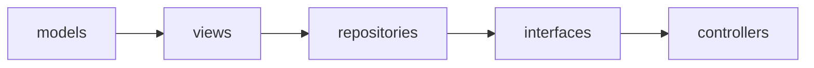

# crud/

The generic CRUD framework `app`'s resource packages (e.g. `app.crud_1.
heroes`) build on — router factories, the CRUD interface, storage-agnostic
repositories, and model/view bases — laid out as the same MVC-ish split
as `app/`, each subpackage with its own `README.md`:

- `models/` — the generic SQLAlchemy declarative base, record-lifecycle
  mixins, and shared revision model.
- `views/` — the generic Pydantic view base and bulk/revision/stats
  response shapes.
- `interfaces/` — the generic CRUD interface, built from a view + a
  repository.
- `repositories/` — storage-agnostic CRUD access, backing `interfaces/`.
- `controllers/` — the generic CRUD router factories.

None of these carry resource-specific code — a resource's own model
(`app.models.hero`), views (`app.views.hero_v1`/`hero_v2`), and router
(`app.crud_1.heroes`) live in `app/` instead and import from here to
build on this framework; see `../app/README.md`'s "Example CRUD
resource: Hero".

## Layering

Import order within `crud/` is strict and one-directional — lower
layers never import from higher ones (`models` → `views` →
`repositories` → `interfaces` → `controllers`) — enforced by
`import-linter`'s `"crud layers"` contract in `../../pyproject.toml`'s
`[tool.importlinter]`, run via `uv run lint-imports` (wired into
`../../.pre-commit-config.yaml`'s manual/pre-push stage, same as mypy).
This contract covers only ordering *within* `crud/` itself; `app/` has
its own separate `"app layers"` contract, documented in `../app/
README.md`'s own "Layering" section. `interfaces/base.py` imports
`aiomqtt` directly (`MQTTEventSink`/`MQTTEventSource`, see `../app/
README.md`'s "Example CRUD resource: Hero") — a third-party dependency,
not another `crud/` module, so it doesn't change this layer order.

This package imports nothing from `app` or `craftainer_tool_observability`;
the `"crud never imports app"` import-linter contract enforces it. Its
generic `xml_codec.py` and `web_components.py` live at the package top
level (below `controllers`, which uses them), not in `app`.

An arrow means "may import from" — each module may depend on anything
to its left, never anything to its right.

## Host integration

The host application owns settings, the database engine and rate limiting;
this package receives them:

- `config.py` — `CrudConfig` (`use_memory`, `bulk_action_max_matched`,
  `sse_keepalive_seconds`, `mqtt: MQTTConfig`) and `configure(config,
  session_factory)`. Call it once at startup, before the first request:
  `models.base.get_db`/`DBSession` open sessions from the injected
  `async_sessionmaker` (`get_session_factory()` raises if none was
  supplied), and providers/routes read `get_config()` at call time. No
  module here creates an engine or reads environment settings.
- Rate limiting: the router factories (`build_resource_router`,
  `build_json_router`, `build_xml_router`) take an optional
  `bulk_rate_limit` route decorator (e.g. `limiter.limit("20/minute")`)
  for the bulk-action routes; `None` means unlimited. This package does
  not depend on `slowapi`.
- Migrations stay app-owned: the app's Alembic setup targets
  `models.base.Base.metadata`, so a release of this package that changes
  its models (`revision`, mixins) needs a new app-side migration
  ([NFR-0019](../../docs/nfrs/NFR-0019-migrations-immutable-once-applied.md)).
- Intended extras once extracted: `[mqtt]` (`aiomqtt`, imported only inside
  `MQTTEventSink`/`MQTTEventSource`) and `[xml]` (`defusedxml`, imported only
  inside `xml_codec.from_xml` and the router's XML-body parsing). In this
  repository both still sit in `[project] dependencies`.

## Do

- Add a new generic, resource-agnostic CRUD capability here (a new
  router factory option, repository method, or view shape usable by any
  future resource) — see each subpackage's own `README.md` for where it
  belongs.

## Don't

- Add resource-specific code anywhere in this package — a resource's
  own model/view/router belongs in `app/` instead, built on top of the
  generic pieces here.
- Import anything from `app` (e.g. `app.models`, `app.config`,
  `app.rate_limit`) — pass what you need in through `config.configure(...)`
  or a factory parameter instead; see "Host integration" above.
